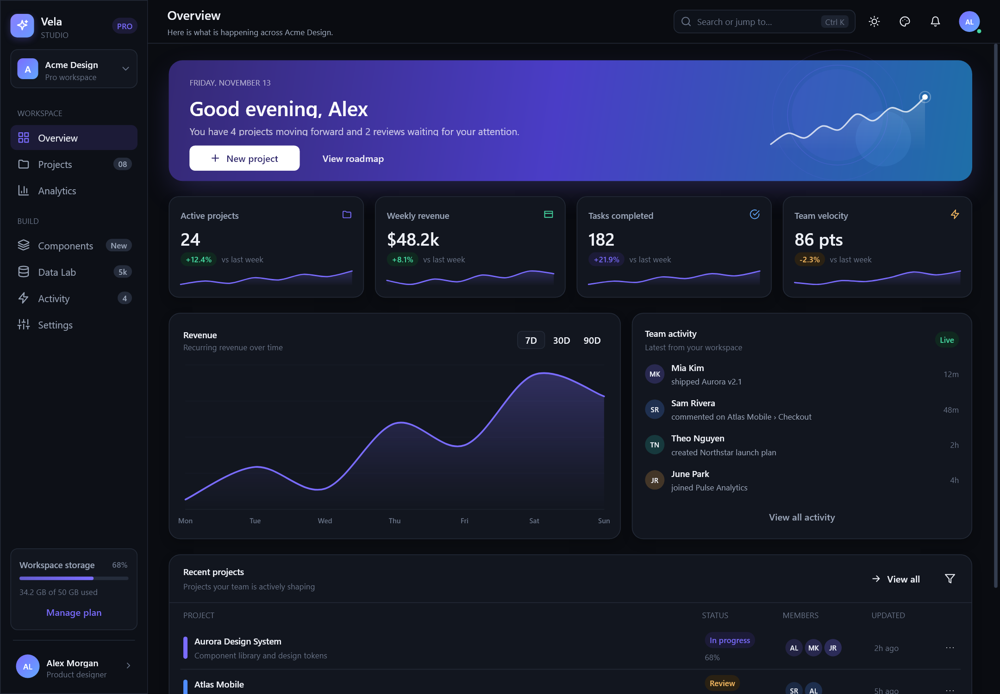
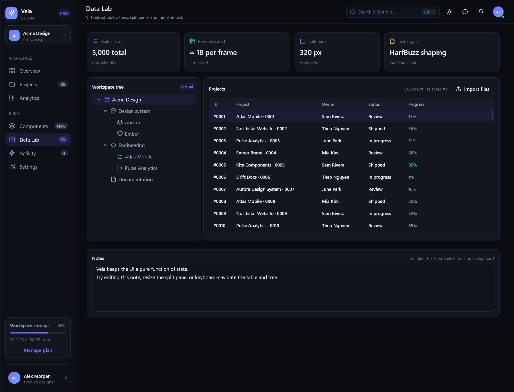

# Vela

**一个面向 .NET 10 的即时模式（immediate-mode）桌面 UI 框架。**

本文是项目入口和总览。需要按程序员视角从零读源码时，看 [READING.md](READING.md)：它沿一次完整帧追踪到具体文件、数据结构和扩展点。

> 第三方许可证与法律文本单独保留在 [THIRD-PARTY-NOTICES.md](THIRD-PARTY-NOTICES.md) 和 [LICENSE](LICENSE)。

---

## 1. 这个项目是什么

Vela 用 C# / .NET 10 实现一个可开发现代桌面应用的即时模式 UI 框架。

它保留即时模式最重要的优点：

- 界面是「状态 + 输入」的函数；
- 没有 ViewModel、数据绑定或持久控件树需要同步；
- 控件就是 C# 方法，组合方式就是普通代码。

同时补上现代应用需要、但普通 imgui/debug UI 通常缺少的基础设施：

- 真正的约束布局（Flex、Grid、Wrap、Dock、SplitPane）；
- 稳定 ID 和跨帧状态；
- 完整鼠标/键盘/焦点/滚动/浮层交互；
- 单行与多行文本编辑、IME、HarfBuzz shaping；
- 虚拟化 DataTable/TreeView；
- UI Automation 可访问性；
- CPU/GPU 渲染、脏区域呈现；
- Win32 与 SDL3 两套桌面宿主；
- 动画、原生文件对话框、拖放和多窗口。

它**不是**：

- 一个保留式（retained-mode）控件库；
- 一个带 XAML/绑定的应用框架；
- 一个已经完成所有平台能力的商业 UI 平台。

---

## 2. 五分钟跑起来

环境：

- .NET SDK **10.0**（本仓库用 10.0.402 验证）；
- Windows 10/11 用于 Win32 宿主和 UIA；
- Windows/macOS/Linux 用于 SDL3 便携宿主。

```powershell
dotnet restore Vela.slnx

# Windows：Win32 + UIA + 文件对话框 + 多窗口能力
dotnet run --project src/Vela.Demo

# 跨平台：SDL3 + Skia（示例默认使用 GPU）
dotnet run --project samples/PortableHello
```

常用验证：

```powershell
dotnet build Vela.slnx -c Release
dotnet test Vela.slnx -c Release

# 原生窗口渲染 30 帧后退出
dotnet run --project src/Vela.Demo -- --smoke 30

# 无窗口截图（不需要显示器）
dotnet run --project src/Vela.Demo -- --snapshot artifacts/data-lab.png --page data-lab --width 1440 --height 1100

# CPU 管线基准
dotnet run --project src/Vela.Demo -c Release -- --benchmark 120 --width 1440 --height 900
```



Data Lab 页面展示了 Grid、SplitPane、Virtualized DataTable、TreeView、TextArea 和动画：



---

## 3. 最重要的心智模型

### 3.1 每帧重新声明

```csharp
app.Run(ui =>
{
    using (ui.Column("app", new Style { Padding = Thickness.All(24), Gap = 12 }))
    {
        ui.Heading("Hello");
        ui.Button("Continue", "continue", ButtonVariant.Primary);
    }
});
```

- 回调每帧执行一次；
- 元素树是临时的，帧结束后不保留控件对象；
- 应用状态在回调外部，交互状态在 `StateStore`；
- `using` 决定父子关系，容器必须正确释放。

### 3.2 稳定 ID + 类型化状态

有状态控件必须拥有跨帧稳定的 `Id`。重复控件或 label 会变化时，显式传 `id:`，或使用 `PushId`：

```csharp
ui.PushId("projects");
for (var i = 0; i < projects.Count; i++)
{
    ui.PushId(projects[i].Id);
    ui.Button("Open", "open");
    ui.PopId();
}
ui.PopId();
```

`StateStore` 的键是 **`(Id, 状态类型)`**，因此同一元素可以同时保存：

- `ScrollState`（滚动位置）；
- `TextAreaState`（光标、选区、撤销栈）；
- `VirtualRowsState`（滚动条拖动、hover）；
- 动画状态。

这避免了「一个元素只能有一个状态对象」的经典冲突。

### 3.3 用上一帧的几何做交互

布局完成之后，本帧会生成 `FrameSnapshot`：

- 每个元素的最终边界和裁剪；
- 可交互/可聚焦/可滚动/文本输入标记；
- 滚动轨道和滑块几何；
- 浮层组和焦点陷阱。

**下一帧**的鼠标命中、焦点导航、滚轮和滚动条拖动都基于这个快照。这样用户点击的永远是屏幕上实际看到的几何，而不是当前帧还没完成的布局。

代价是：新创建的元素通常从下一帧开始交互。这是有意的取舍，不是布局 bug。

---

## 4. 一帧发生了什么

```text
Build
  Ui.Button / Grid / ScrollArea / Canvas ...
        │
        ▼
Layout
  约束求解：Flex / Grid / Wrap / Dock / SplitPane
        │
        ▼
Snapshot
  FrameSnapshot：几何、裁剪、命中目标、焦点、滚动
        │
        ├──────────────► Paint
        │                 DrawList：与后端无关的绘制命令
        │                    │
        │                    ├─ Skia CPU（脏区域增量）
        │                    └─ Skia OpenGL GPU（当前整帧）
        │
        └──────────────► Accessibility
                          AccessibilitySnapshot → Win32 UIA
```

### Build

`Ui.BeginFrame` 创建新的 `Frame`。应用的 UI 方法构建临时元素树：

- 容器建立作用域；
- 控件写入文本、图标、样式、payload 和可访问性语义；
- 交互响应来自上一帧快照；
- 状态从 `StateStore` 读取/写回。

### Layout

`Frame.Complete` 先完成构建，然后执行布局：

- `Constraints` 表达最小/最大尺寸和紧约束；
- Flex 支持 Row/Column、固定/百分比/自动/Grow/Shrink、Gap、Margin、Padding、对齐和绝对定位；
- Grid 支持 Points/Percent/Auto/Star 轨道、自动放置和跨行跨列；
- Wrap 按可用宽度流式换行；
- Dock 用 `DockSide.Top/Bottom/Left/Right/Fill` 占用区域；
- SplitPane 由两个面板和一个可拖分割条组成。

最终几何写入 `Element.Bounds` 和 `ContentBounds`。

### Snapshot

`FrameSnapshot` 是下一帧交互的依据。它同时暴露给诊断，用于查看元素几何和命中信息。

### Paint

绘制遍历元素树，把背景、边框、阴影、文本、路径、图片、裁剪、变换、透明度写入扁平的 `DrawList`。

`DrawList` 是渲染器契约：

- 不包含控件/布局/平台概念；
- CPU 和 GPU 后端消费同一份命令；
- 命令顺序就是绘制顺序，Push/Pop 必须平衡。

### Accessibility

每个元素可携带：

- `AccessibilityRole`
- `AccessibilityName`
- `AccessibilityValue`
- `AccessibilityHelp`

`Frame.Complete` 生成 `AccessibilitySnapshot`；Win32 宿主把它桥接为 UI Automation。内置控件会自动设置角色和名称，`Ui.Semantic(...)` 可以标注自定义控件。

### Damage / Present

CPU 路径用 `DrawDamageTracker` 比较前后两帧的 DrawList：

- 首帧、尺寸变化、变换/透明度变化 → 整帧；
- 悬停、光标闪烁、局部状态变化 → 只重绘变化的包围矩形；
- 只有存在脏区域时才 Present。

GPU 路径使用 Skia OpenGL 默认 framebuffer。由于交换后默认 framebuffer 内容不保证保留，当前 GPU 路径每帧整帧绘制。

---

## 5. 代码阅读顺序

> 更详细的从零阅读路线、调试技巧、扩展步骤和术语表见 [READING.md](READING.md)。

如果第一次读这个项目，建议按下面顺序：

| 顺序 | 文件 | 看什么 |
|---|---|---|
| 1 | `src/Vela.Core/Ui.cs` | 应用入口、`Run`、文本/容器基础方法 |
| 2 | `src/Vela.Core/Runtime/Frame.cs` | Build → Layout → Snapshot → Paint → Result |
| 3 | `src/Vela.Core/Runtime/Element.cs` | 临时元素、ID、payload、状态 |
| 4 | `src/Vela.Core/Runtime/FrameDiagnostics.cs` | 一帧的可观测输出 |
| 5 | `src/Vela.Core/Widgets/FlexWidget.cs` | 最核心的约束布局 |
| 6 | `src/Vela.Core/Widgets/GridWidget.cs`、`WrapWidget.cs`、`DockWidget.cs` | 其他布局容器 |
| 7 | `src/Vela.Core/Interaction/InteractionFrame.cs` | 命中、焦点、滚动、空间导航 |
| 8 | `src/Vela.Core/Widgets/TextFieldWidget.cs`、`TextAreaWidget.cs`、`Text/TextBlockLayout.cs` | 文本编辑 |
| 9 | `src/Vela.Rendering.Skia/SkiaTextEngine.cs` | 字体回退、HarfBuzz shaping |
| 10 | `src/Vela.Core/Rendering/DrawList.cs`、`src/Vela.Rendering.Skia/SkiaRenderer.cs` | 绘制协议与后端 |
| 11 | `src/Vela.Desktop/DesktopApp.cs` | Win32 主循环 |
| 12 | `src/Vela.Desktop.Portable/PortableApp.cs` | SDL3 便携循环 |
| 13 | `src/Vela.Demo` | 真实应用如何组织页面、主题和浮层 |

### 目录结构

```text
src/
  Vela.Core/              跨平台核心
    Primitives/           几何、颜色、字体、枚举
    Foundation/           Id、StateStore
    Runtime/              Frame、Element、Widget、Snapshot、Diagnostics
    Widgets/              Flex、Grid、Wrap、Dock、Text、Button、DataTable、TreeView...
    Interaction/          命中、焦点、滚动、浮层、程序化 Invoke
    Rendering/            DrawList、Path、Icon、Texture 抽象
    Text/                 ITextEngine、TextBlockLayout、编辑辅助
    Accessibility/        语义角色、AccessibilitySnapshot
    Theming/              Theme、Style、FontSpec
  Vela.Rendering.Skia/    CPU/GPU Skia、HarfBuzz、脏区域
  Vela.Platform.Win32/    Win32 窗口、IME、文件对话框、拖放、多窗口、UIA
  Vela.Platform.Sdl/      SDL3 窗口、输入、剪贴板、OpenGL 窗口
  Vela.Desktop/           Win32 桌面循环 + 多窗口宿主
  Vela.Desktop.Portable/  SDL3 桌面循环（CPU/GPU）
  Vela.Demo/              Vela Studio 六个页面的示例应用
  samples/PortableHello/  最小跨平台示例
tests/
  Vela.Core.Tests/        布局、交互、文本、虚拟化、动画、可访问性
  Vela.Rendering.Tests/   Skia、HarfBuzz、图标、脏区域
```

依赖方向始终是：`Demo → Desktop → Platform/Rendering → Core`。`Vela.Core` 不引用 Skia、Win32 或 SDL。

---

## 6. 关键能力与入口

### 6.1 布局

```csharp
using (ui.Grid(
    "dashboard",
    [GridTrack.Px(260), GridTrack.Star(), GridTrack.Star()],
    style: new Style { Gap = 14 }))
{
    using (ui.Panel("sidebar", new Style { GridRowSpan = 2 })) { }
    using (ui.Panel("chart", new Style { GridColumn = 1, GridColumnSpan = 2 })) { }
}
```

- Flex：`Row`、`Column`、`Panel`、`Card`、`ScrollArea`
- Grid：`GridTrack.Px/Percent/Auto/Star`，`Style.GridColumn/GridRow/...Span`
- Wrap：`Wrap`
- Dock：`Dock` + `Style.Dock`
- 可拖分栏：`SplitPane`

### 6.2 文本

```csharp
ui.TextField("email", ref email, "you@example.com");

ui.TextArea("notes", ref notes, "Write a note…", style: new Style { Height = 160 });
```

文本链路：

- `ITextEngine`：字体选择、回退、测量、行高、命中测试、绘制；
- `SkiaTextEngine`：Skia + HarfBuzzSharp shaping；
- `TextBlockLayout`：多行可视行、光标映射、点击映射；
- `TextArea`：换行、选区、剪贴板、撤销/重做、垂直滚动；
- IME：`FrameInput.CompositionText` 作为未提交 preedit 绘制。

### 6.3 交互与焦点

- 命中测试考虑裁剪、浮层顺序、pass-through 和焦点陷阱；
- 鼠标：hover / pressed / held / clicked / double-click / right-click；
- 键盘：Tab、方向键空间导航、Enter/Space 激活；
- 文本编辑器、滑块、分割条、虚拟列表通过 `NodeFlags.ArrowKeys` 自行消费方向键；
- Popup/Modal 打开时把焦点移入陷阱，关闭后恢复之前的焦点；
- `Ui.Invoke(id)` 和 UIA Invoke 走同一个程序化点击队列。

### 6.4 数据视图

- `VirtualList`：固定行高、虚拟化绘制；
- `DataTable<T>`：固定表头 + 虚拟化行 + 选中；
- `TreeView`：应用提供扁平化的 `TreeRow` 列表，组件负责虚拟化和点击 chevron。

示例见 `src/Vela.Demo/DemoApp.Pages.cs` 的 `BuildDataLabPage`。

### 6.5 可访问性

- 内置控件自动附带 `AccessibilityRole` 和名称；
- `Ui.Semantic(...)` 标注自定义控件；
- `Ui.Invoke(id)` 可程序化触发点击；
- Win32 UIA provider 暴露 Name、ControlType、BoundingRectangle、IsEnabled、焦点、Invoke/Toggle/SelectionItem 和焦点变化事件。

### 6.6 渲染

- `DrawList`：后端无关命令；
- `SkiaRenderer`：CPU 表面；
- `DrawDamageTracker`：CPU 脏区域；
- `SkiaGpuRenderer`：OpenGL GPU；
- `SkiaTextEngine`：HarfBuzz shaping 和字体回退。

### 6.7 平台

| 宿主 | 项目 | 能力 |
|---|---|---|
| Win32 | `Vela.Desktop` / `Vela.Platform.Win32` | DPI、GDI 呈现、IME、文件对话框、拖放、多窗口、UIA |
| SDL3 | `Vela.Desktop.Portable` / `Vela.Platform.Sdl` | Windows/macOS/Linux 窗口、输入、剪贴板、CPU/GPU |

### 6.8 动画

```csharp
var hover = ui.Animate("hover", isHovered ? 1f : 0f, speed: 18f, initial: 0f);
var color = ui.AnimateColor("accent", targetColor, speed: 16f);
var lift = ui.Spring("card-lift", isHovered ? 1f : 0f, stiffness: 180, damping: 18);
```

- `Animate`：指数平滑；
- `AnimateColor`：颜色插值；
- `Spring`：阻尼弹簧；
- 按钮和 Toggle 已内置过渡。

---

## 7. 当前状态

| 能力 | 状态 |
|---|---|
| Flex/Grid/Wrap/Dock/SplitPane | 已实现 |
| 文本编辑、TextArea、IME 输入抽象、HarfBuzz shaping | 已实现；完整 bidi/RTL 仍缺 |
| VirtualList/DataTable/TreeView | 已实现；表格列宽固定，无排序 |
| 焦点/方向键/焦点陷阱/焦点恢复 | 已实现 |
| UIA | 已实现基础树、焦点事件、Invoke/Toggle/SelectionItem；无 SetValue |
| CPU 脏区域 | 已实现 |
| OpenGL GPU | 已实现；每帧整帧绘制，无自动回退 |
| Win32 文件对话框/拖放/多窗口 | 已实现 |
| SDL3 跨平台窗口/输入/CPU/GPU | 已实现；文件对话框/多窗口管理器未封装 |
| 动画 | Tween/Color/Spring；无时间线/过渡 DSL |
| 测试 | 31 个 Core + 7 个 Rendering，共 38 个 |

验证命令：

```powershell
dotnet test Vela.slnx
dotnet run --project src/Vela.Demo -- --smoke 30
dotnet run --project src/Vela.Demo -- --snapshot artifacts/data-lab.png --page data-lab
```

基准：

```powershell
dotnet run --project src/Vela.Demo -c Release -- --benchmark 120 --width 1440 --height 900
```

---

## 8. 已知边界与设计取舍

- **一帧交互延迟**：命中测试使用上一帧几何，新元素下一帧才可交互。
- **GPU**：OpenGL 3.3 Core；默认 framebuffer 不持久，当前每帧整帧绘制；没有自动回退。
- **文本**：没有完整 bidi/RTL 重排、富文本 span、字间距、可变字体轴、复杂语言断词、代码编辑器。
- **数据**：DataTable 列宽固定，无排序/列宽拖动/水平滚动；TreeView 需要应用扁平化节点。
- **布局**：没有 CSS 的 min-content/container query、Dock 布局持久化。
- **交互**：没有拖拽排序、多选模型、全局命令系统。
- **无障碍**：UIA provider 数据只读，不支持直接设置文本值/范围；没有高对比度回归。
- **平台**：只有 Win32 有 UIA/文件对话框/多窗口；SDL3 文件对话框未封装。
- **桌面**：没有自定义标题栏、托盘、通知、全局快捷键、窗口状态持久化、单实例。
- **动画**：没有时间线、编排器、退出过渡 DSL。
- **工程化**：没有 NuGet 发布、CI 配置、视觉 golden 基线。

这些不是隐藏的缺陷，而是当前版本明确的范围。

---

## 9. 从哪里开始改

### 加一个控件

1. 在 `src/Vela.Core/Widgets` 新建 `Widget`；
2. 实现 `Measure` / `Arrange` / `PaintContent`；
3. 在 `Ui` partial 方法中创建元素、设置 payload、调用 `frame.UpdateResponse`；
4. 设置 `AccessibilityRole` / `AccessibilityName`；
5. 如果需要键盘或滚动，设置 `TextInput` / `HandlesArrowKeys` / `IsScrollable`；
6. 在 `tests/Vela.Core.Tests` 增加布局和交互测试；
7. 在 `src/Vela.Demo` 中实际使用一次。

### 加一个渲染后端

实现一个消费 `DrawList` 的 renderer：

- 遍历 `DrawCommandKind`；
- 处理 FillRect/StrokeRect/BoxShadow/Text/Line/FillPath/StrokePath/Image；
- 正确处理 PushClip/PopClip、PushTransform/PopTransform、PushOpacity/PopOpacity；
- CPU 后端还需要实现 `ITexture` 和文本引擎。

### 加一个平台宿主

最小要求：

- 窗口与 DPI；
- `InputBuilder` 事件；
- BGRA 像素或 GPU surface 呈现；
- `IClipboard`；
- 关闭/尺寸变化。

Win32 额外能力（IME、文件对话框、UIA、多窗口）不是跨平台核心的必需接口。

### 调试

打开 `CaptureDiagnostics`：

```csharp
var app = new DesktopApp(new DesktopAppOptions { CaptureDiagnostics = true });
```

`FrameDiagnostics` 提供：

- 元素几何；
- DrawList 命令数；
- 布局/绘制/快照耗时；
- hovered/active/focused ID。

`--snapshot` 会输出元素数、命令数和阶段耗时。

---

## 10. 许可证

MIT，见 [LICENSE](LICENSE)。第三方库和 Lucide 图标的声明见 [THIRD-PARTY-NOTICES.md](THIRD-PARTY-NOTICES.md)。

